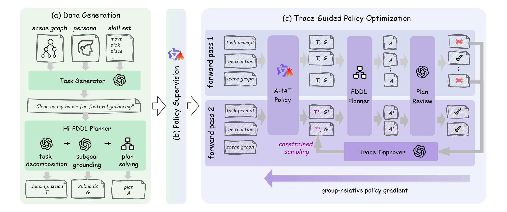

# TGPO: Trace-Guided Policy Optimization

[Paper](https://arxiv.org/abs/2602.12244) ·
[Project page](https://sii-liyang2024.github.io/ahat/) ·
[Model](https://huggingface.co/Sii-liuzhihong/AHAT-TGPO) ·
[Dataset](https://huggingface.co/datasets/SII-liyang2024/AHAT-dataset)

This repository contains **Trace-Guided Policy Optimization (TGPO)**, the training
method used in **AHAT: Any House Any Task**. It provides supervised fine-tuning,
TGPO reinforcement learning, model inference, and subgoal evaluation for
long-horizon household planning.

TGPO uses external feedback to repair reasoning traces in selected low-reward
rollout groups, generates continuations with the policy, and replaces samples
only when their scores improve. It then applies the existing GRPO update.
Training rewards and offline evaluation share one task evaluator.




The framework base is verl commit `a7b8675f9674999e2c6b75a402d95837eca40a3d`;
see [UPSTREAM.md](UPSTREAM.md) for provenance and the original snapshot differences.
This release excludes private raw data, custom checkpoint/debug tools, backup
trainers and unrelated evaluation methods. Public examples are hand-written.

## Score existing predictions on CPU

Use Python 3.11. Clone the repository and create an environment:

```bash
git clone https://github.com/Sii-liuzhihong/AHAT.git
cd AHAT
python3.11 -m venv .venv
source .venv/bin/activate
python -m pip install '.[eval]'
bash scripts/setup_fast_downward.sh
export FAST_DOWNWARD_PATH="$PWD/third_party/fast-downward/fast-downward.py"
python -m robot_planning.evaluation.cli \
  --input recipe/tgpo/examples/predictions.jsonl \
  --output-dir outputs/example_eval --mode only_validate --workers 1
```

Building the pinned planner requires a C++ compiler, CMake and Make. Alternatively,
set `FAST_DOWNWARD_PATH` to an existing installation. `only_validate` runs without
an LLM endpoint, PyTorch, Ray or vLLM. The supplied valid example scores 1 and
produces a real action plan. Results, metrics and version/configuration hashes
are written separately. The recipe wrapper selects only the first candidate,
matching the historical script; the API/CLI can also score all candidates.

Full scoring additionally reviews the plan using an OpenAI-compatible endpoint:

```bash
export OPENAI_BASE_URL=http://localhost:8000/v1
export TGPO_LLM_MODEL=your-served-model
export TGPO_LLM_SEED=7
# Set OPENAI_API_KEY in the environment if your endpoint requires authentication.
python -m robot_planning.evaluation.cli \
  --input recipe/tgpo/examples/predictions.jsonl \
  --output-dir outputs/reviewed_eval --mode validate_first --repeats 1
```

`Good`, `Normal`, `Bad` map to 1, 0.5, 0. The final score is validation × review.
With `--repeats 2`, the **entire** evaluator runs twice and the lower-score result
is selected; ties select the second result. See [evaluation.md](docs/tgpo/evaluation.md).

## Download model and data

```bash
python -m pip install '.[download]'
python scripts/download_model.py
python scripts/download_data.py
```

Downloads default to `models/AHAT-TGPO` and `data/AHAT-dataset`. The released
model is for inference; SFT starts from your chosen base model. Convert public
or user-provided records to the [canonical schema](docs/tgpo/data.md) before
training. Private raw-data extraction is outside this repository.

To serve the model locally after installing the inference dependencies:

```bash
python scripts/deploy_model.py --model models/AHAT-TGPO --port 8000
```

This exposes an OpenAI-compatible endpoint. Review and repair configuration uses
`OPENAI_BASE_URL`, `OPENAI_API_KEY` and `TGPO_LLM_MODEL`; see [.env.example](.env.example).
Modules read environment variables directly. To load your own `.env` in Bash,
use `set -a; source .env; set +a` before running commands.

## Prepare data and train

```bash
python -m pip install -r requirements/train.txt
```

CUDA training additionally requires FlashAttention 2.7.4.post1 built for your
Python, PyTorch 2.7 and CUDA/C++ ABI. Install a matching upstream wheel or build
that version. The verified environment uses Python 3.11, torch 2.7.0, vLLM 0.9.1,
transformers 4.51.3 and tensordict 0.8.3. Dependency details and actual test scope
are recorded in [validation.md](docs/tgpo/validation.md).

The public boundary is canonical JSON/JSONL after private data extraction:

```bash
python -m robot_planning.data.prepare_sft \
  --input /path/to/train.jsonl --output outputs/data/sft_train.parquet
python -m robot_planning.data.prepare_rl \
  --input /path/to/train.jsonl --output outputs/data/rl_train.parquet
```

Prepare validation files separately. The single-task examples document the
schema and support scoring smoke tests; use a dataset and batch size appropriate
for actual training. See [data.md](docs/tgpo/data.md) for fields, nested SFT keys,
prompt differences and domain paths.

```bash
export TGPO_MODEL=/path/to/base_hf_model
export TGPO_TRAIN_DATA="$PWD/outputs/data/sft_train.parquet"
export TGPO_VAL_DATA="$PWD/outputs/data/sft_val.parquet"
export TGPO_OUTPUT="$PWD/outputs/sft"
N_GPUS=8 bash recipe/tgpo/train_sft.sh

# Export using verl's existing tool; no custom checkpoint manager is needed.
python -m verl.model_merger merge --backend fsdp \
  --local_dir outputs/sft/global_step_STEP --target_dir outputs/sft_hf

export TGPO_MODEL="$PWD/outputs/sft_hf"
export TGPO_TRAIN_DATA="$PWD/outputs/data/rl_train.parquet"
export TGPO_VAL_DATA="$PWD/outputs/data/rl_val.parquet"
export TGPO_OUTPUT="$PWD/outputs/tgpo"
N_GPUS=8 bash recipe/tgpo/train_tgpo.sh
```

Replace `STEP` with the saved step. Repair/review use the endpoint configured
above; workers also need access to the domain and planner executable. Recipe
configs represent a candidate historical configuration, rather than an
author-confirmed main-result preset. For fewer GPUs, override batch sizes and
rollout tensor parallelism together. Details are in [recipe/tgpo](recipe/tgpo/README.md).

Export a TGPO checkpoint from `outputs/tgpo/global_step_STEP/actor` using the same
upstream merger. Generate predictions and optionally score them in one command:

```bash
python -m robot_planning.inference --model outputs/tgpo_hf \
  --input /path/to/test.jsonl --output outputs/predictions.jsonl \
  --score-output outputs/scored.jsonl
```

## Code and validation

```text
verl/trainer/tgpo/       selection, refinement and consistent tensor replacement
verl/trainer/ppo/        one shared training loop; unchanged GRPO/PPO objectives
robot_planning/          data, repair, PDDL, scene state, evaluator and reward
recipe/tgpo/             short launch scripts, configs and synthetic examples
tests/                   standalone tests and opt-in original-source comparisons
scripts/validation/      real model, native training and checkpoint parity harnesses
```

[Migration scope](docs/tgpo/migration.md) lists exclusions, consolidation and
explicit defect fixes. [Training notes](docs/tgpo/upstream_training_notes.md)
explain grouping, threshold/tie rules, prefix masks and probability recomputation.
[Validation](docs/tgpo/validation.md) separates exact source comparisons, live
model/solver tests, native CUDA runs and untested research-scale configurations.

```bash
python -m pip install '.[data,test]'
python -m pytest tests/robot_planning -q
# With training dependencies installed:
python -m pytest tests/tgpo -q
# Optional: read-only comparisons against a separate original checkout.
TGPO_SOURCE_ROOT=/path/to/original/decision_making python -m pytest tests -q
python scripts/validation/verify_release.py
```

Without the private source or optional GPU/model endpoints, relevant differential
and integration tests explicitly skip. They are not counted as executed tests.
The private dataset and full-scale experiment results are not included; the
examples demonstrate runnable interfaces, not research performance.

## Migration from the earlier AHAT package

The earlier `src/ahat` implementation and `ahat` command are replaced by the
shared `robot_planning` package and verl training entries. Use
`python scripts/download_model.py`, `python scripts/download_data.py`,
`python -m robot_planning.inference`, and
`python -m robot_planning.evaluation.cli` for the corresponding workflows.
Inference uses local vLLM; the old API-generation pipeline is not retained.
External APIs remain supported for trace repair and plan review.

The original [AHAT domain](examples/ahat_domain.pddl) is retained for compatible
household tasks. The separate [minimal domain](recipe/tgpo/examples/domain.pddl)
is only for the synthetic smoke examples; use the domain matching your data.
See [repository migration](docs/tgpo/ahat_integration.md) for integration details.

## Citation

TGPO is the training method introduced in the AHAT paper:

```bibtex
@article{liu2026ahat,
  title={Any House Any Task: Scalable Long-Horizon Planning for Abstract Human Tasks},
  author={Liu, Zhihong and Li, Yang and Huang, Rengming and Lu, Cewu and Cai, Panpan},
  journal={arXiv preprint arXiv:2602.12244},
  year={2026}
}
```

## License and acknowledgements

The migrated TGPO code and vendored verl fork use
[Apache-2.0](LICENSES/Apache-2.0.txt), with upstream [NOTICE](NOTICE) retained.
The existing AHAT assets, domain, and adapted utility scripts retain their
[MIT license](LICENSE). See [third-party notices](THIRD_PARTY_NOTICES.md) for
license scope and external planner terms.

We thank the teams behind [verl](https://github.com/verl-project/verl),
[Fast Downward](https://github.com/aibasel/downward), and
[Qwen](https://huggingface.co/Qwen).
